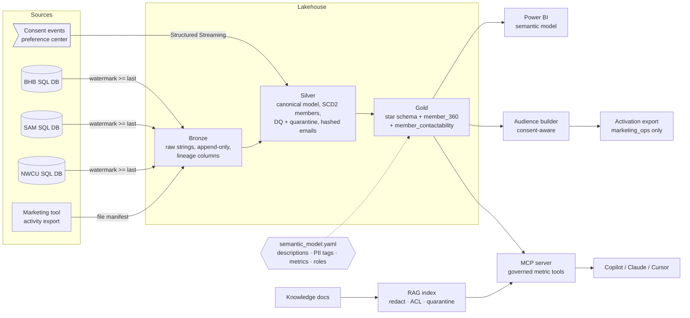

# Consent-aware, AI-ready travel marketing lakehouse

A working, tested reference implementation of the data platform for a **white-label
travel-rewards business**. Partner brands each run their own on-prem database, marketing
needs consent-safe audiences, and AI assistants need governed access to the *same* curated
data that Power BI uses, without a second "AI layer" to build and maintain.

It runs end-to-end on a laptop (PySpark + Parquet, or Delta) and every component maps
1:1 to a Microsoft Fabric item ([docs/fabric_mapping.md](docs/fabric_mapping.md)). All data is
synthetic: the partners, members and emails are fictional.

```
make setup     # Python 3.10+ and Java 17+
make demo      # ~1 minute: day-1 load, day-2 incremental, audiences, RAG, MCP queries
make test      # 50 tests: end-to-end Spark run + unit tests
```

## Dashboard and REST API

After `make demo`, run `make api` (add `TLAKE_TABLE_FORMAT=delta` if you built Delta tables) and open:

* **http://127.0.0.1:8000/**: a visual dashboard with booking value, email engagement, marketable
  members by country, a consent-aware audience builder and knowledge search. Switch "Viewing as"
  at the top to see partner isolation and small-group suppression change the results.
* **http://127.0.0.1:8000/docs**: interactive API docs where you can try every endpoint.

| Endpoint | What it does |
|---|---|
| `GET /api/principals`, `GET /api/me` | Identities you can act as, and what your role allows |
| `GET /api/metrics`, `GET /api/datasets/{name}` | Governed metrics and the columns you may see |
| `POST /api/query` | A metric, grouped and filtered from an allow-list (no SQL) |
| `POST /api/audience/estimate` | Audience size after consent suppression; counts only |
| `GET /api/knowledge/search?q=` | ACL-filtered search over brand and policy docs |
| `GET /api/freshness` | As-of date, last run and open data-quality issues |

The caller is chosen with the `X-Principal` header. That is a stand-in for real authentication in
this local demo; in production the principal comes from a verified token. The API calls the same
`serving` layer as the MCP server, so the same rules apply, and every call is logged to
`lakehouse/_state/api_audit.jsonl`.

Results from a demo run are in [docs/demo_output.md](docs/demo_output.md), so you can read them without running anything.

---

## The problem it solves

| Business need | What the platform does |
|---|---|
| Partners' data lives in separate on-prem DBs with **different schemas** | Metadata-driven ingestion: a new partner is a YAML entry in `config/sources.yaml`, not new code |
| Move to cloud and **consolidate** without breaking reports | Medallion lakehouse (bronze → silver → gold) with incremental watermarks, DQ gates and idempotent merges |
| **One layer** for both BI and AI | A single semantic model (`config/semantic_model.yaml`) drives Power BI definitions, masking/RLS, *and* the AI tools |
| Marketing audiences that respect **GDPR / CASL / CAN-SPAM** | Consent stream (opt-outs win, event-time ordering), jurisdiction-aware contactability, consent re-checked at export |
| Let AI assistants answer data questions **safely** | MCP server with governed, read-only metric tools: partner isolation, no PII, small-group suppression, audit log |
| Use internal docs (brand rules, policies) in AI answers | RAG with PII redaction at ingest, ACL filtering *before* similarity search, prompt-injection quarantine, citations |
| Cut SaaS tooling cost | Audience selection runs in the lakehouse; the marketing tool only receives the final, consented list |

## Architecture



## What's in the box

| Area | Where | Highlights |
|---|---|---|
| Incremental ingestion | `src/tlake/bronze.py`, `config/sources.yaml` | Per-table high-watermarks (`>=`, at-least-once), file manifest, watermark advanced only after a successful write, schema-on-read bronze |
| Conformance + SCD2 | `src/tlake/silver.py` | Three partner schemas → one contract via Spark SQL expressions in config; SCD Type 2 members (tracked vs Type 1 attributes); idempotent re-runs |
| Data quality | `src/tlake/quality.py`, `config/quality.yaml` | `error` stops the run, `quarantine` holds rows with reasons, `warn` logs; orphan bookings (late-arriving members) are retried every run; volume-spike check |
| Streaming | `src/tlake/consent.py` | Structured Streaming with checkpoints; event-time wins (a late CRM backfill can't undo an opt-out); ties resolve to opt-out; raw email hashed in-stream |
| Gold model | `src/tlake/gold.py` | `dim_member` (SCD2), `fact_booking` with **point-in-time** tier, `fact_email_engagement`, `member_360` features, `member_contactability` |
| Audiences | `src/tlake/audience.py`, `config/campaigns/` | Small typed criteria language (no SQL from users); suppression funnel by reason; export re-checks consent and is role-restricted and audited |
| Governance | `src/tlake/governance.py` | Classification → drop / mask / allow per role; partner row-level security; **generates Fabric T-SQL** for dynamic data masking + RLS ([docs/generated/fabric_security.sql](docs/generated/fabric_security.sql)) and a Purview label map |
| AI serving | `src/tlake/serving.py`, `src/tlake/mcp_server.py` | Metrics only from the semantic model, allow-listed group-bys/filters, k-anonymity (groups < 10 suppressed), identity from deployment not from the model, audit log |
| RAG | `src/tlake/rag/` | Heading-aware chunking with overlap, PII redaction before embedding, ACL pre-filter, injection quarantine, "I don't know" threshold, citation post-check; Azure OpenAI embeddings/chat if configured |
| CI/CD | `.github/workflows/ci.yml` | Lint + full test suite + check that the generated security SQL matches the semantic model |

## Design decisions worth discussing

The trade-offs are written up in [docs/design_decisions.md](docs/design_decisions.md). The short version:

1. **One semantic layer, many consumers.** Business definitions, PII classification and
   metric logic live in one file. Power BI, the governance views and the AI tools all read it,
   so "gross booking value" means the same thing to an analyst and to an agent.
2. **Agents get metrics, not SQL.** A typed metric API removes SQL injection, keeps numbers
   consistent with reporting, and gives one place to enforce partner isolation and suppression.
3. **Security happens at ingestion, not only at question time.** PII is redacted before
   embedding, ACLs filter before ranking, and suspicious passages never reach the model.
   Prompt injection is handled in layers, because no single filter is reliable.
4. **Consent is a stream, and it's checked twice.** Opt-outs update within a micro-batch.
   Exports re-check consent, because an audience built at 9:00 can be stale by 9:05.
5. **Bad data is held back, not silently dropped.** Quarantine tables record why each row
   failed. Fixes at the source flow through automatically on the next run.

## Using the MCP server with an AI assistant

```json
{
  "mcpServers": {
    "travel-lakehouse": {
      "command": "python",
      "args": ["-m", "tlake.mcp_server"],
      "env": {"PYTHONPATH": "/path/to/repo/src", "TLAKE_PRINCIPAL": "agent:sam-marketing-copilot"}
    }
  }
}
```

Tools: `list_datasets`, `describe_dataset`, `list_metrics`, `query_metric`,
`estimate_audience`, `search_knowledge`, `data_freshness`. The `TLAKE_PRINCIPAL` setting
decides what the assistant can see. The same server can be deployed per partner brand.

## Running on Delta / Fabric

* Delta locally: `pip install delta-spark==3.2.1 deltalake` and set `TLAKE_TABLE_FORMAT=delta`.
* Fabric: set `TLAKE_LAKE=/lakehouse/default/Files` (or use Tables), `TLAKE_TABLE_FORMAT=delta`,
  and run the modules as notebook activities in a Data Pipeline. See [docs/fabric_mapping.md](docs/fabric_mapping.md).
* Azure OpenAI (optional): set `AZURE_OPENAI_ENDPOINT`, `AZURE_OPENAI_API_KEY`,
  `AZURE_OPENAI_EMBEDDING_DEPLOYMENT` and `AZURE_OPENAI_CHAT_DEPLOYMENT`.

## Honest limitations

* Local storage is Parquet folders with staged overwrites. On Delta at scale, the silver
  upserts become `MERGE INTO`; the SQL is in the design doc.
* The offline embedder is lexical TF-IDF, so retrieval works on keywords, not meaning. Use
  Azure OpenAI embeddings for semantic recall. The security controls don't depend on which embedder is used.
* The consent stream reads a landing folder in place of Event Hubs / Eventstream. The
  semantics (checkpointing, event-time ordering, idempotency) are the same.
* Consent rules are simplified for the demo and are not legal advice.

## Layout

```
config/            sources, DQ rules, consent policy, semantic model, campaign specs
src/tlake/         generate · bronze · silver · quality · consent · gold · audience
                   governance · serving · mcp_server · rag/ (ingest, embed, retrieve)
knowledge/         brand guidelines and policies for RAG (one deliberately poisoned)
tests/             end-to-end + unit tests
docs/              design decisions, Fabric mapping, demo output, generated SQL
```
